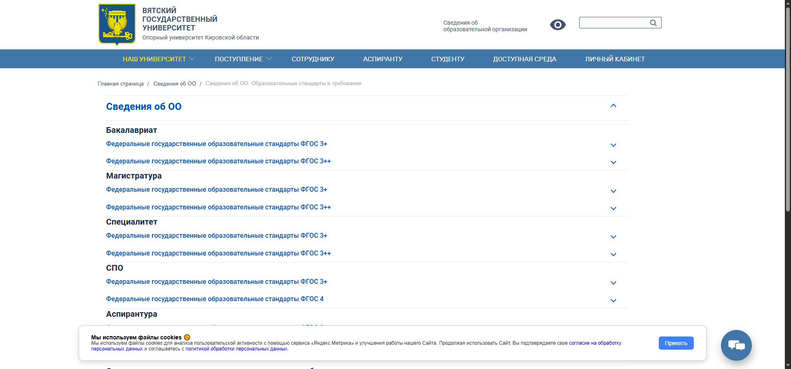
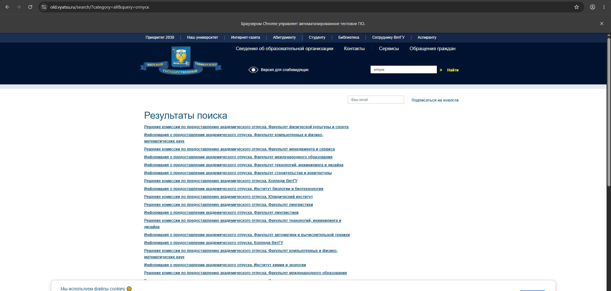
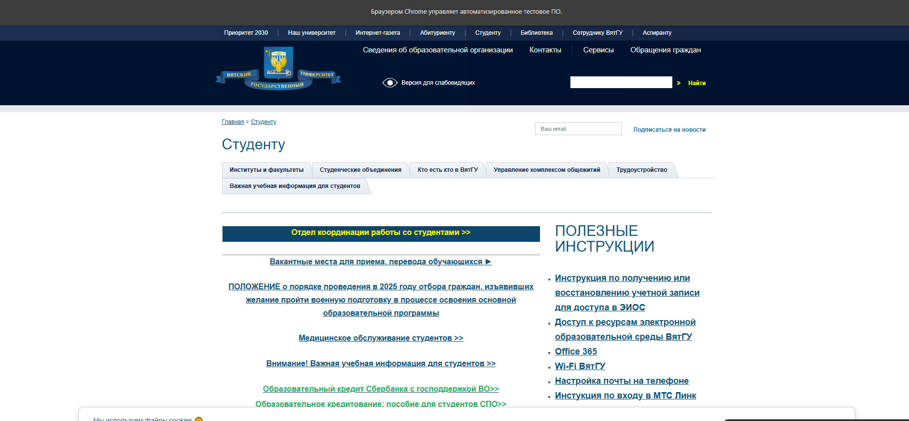
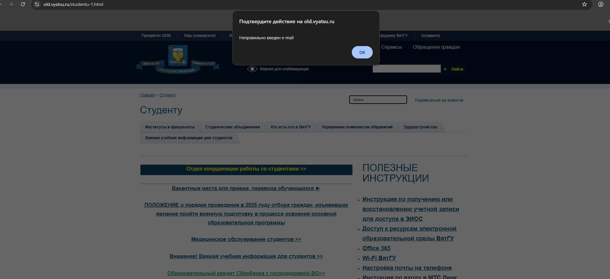
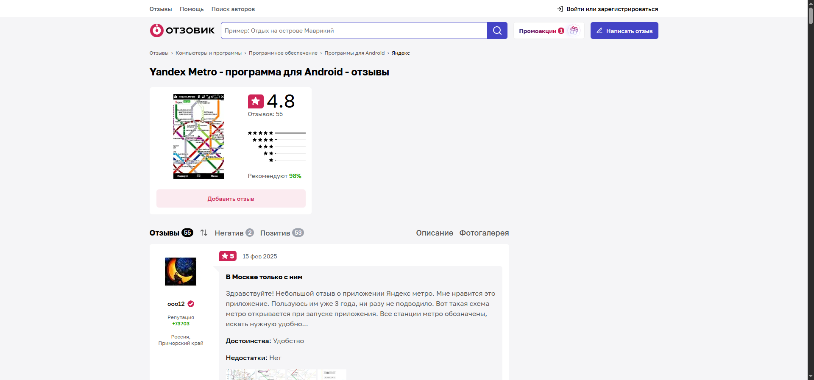
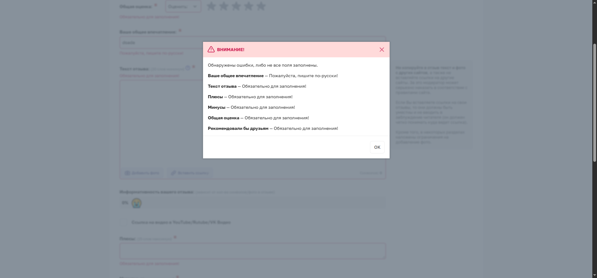
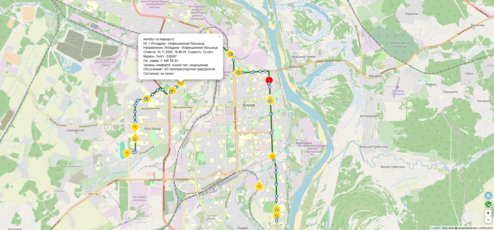
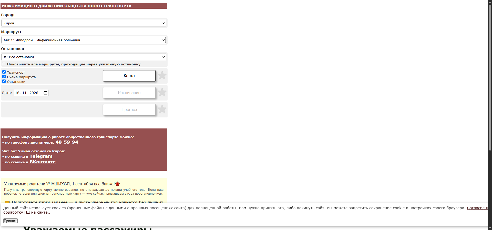

Задача 1. На сайте https://old.vyatsu.ru выполните следующие сценарии.

Сценарий 1. Откройте меню Сведения об образовательной организации, выберите пункт Образовательные стандарты. Перейдите на эту эту страницу. Убедитесь, что отображается верная страница.

Сценарий 2. Получите результаты поиска по слову отпуск со страницы. Убедитесь, что результат поиска не пустой.

Сценарий 3. Перейдите на страницу Студенту. Выполните подписку на новости. Определите результат подписки в случае корректного и некорректного e-mail.

Задача 2.
На сайте https://otzovik.com выполните следующие сценарии.

Сценарий 1. В поисковой строке введите "яндекс". В выпадающем списке выберите "Yandex Metro - программа для Android". Убедитесь, что открылась нужная страница, количество отзывов не пусто.

Сценарий 2. Нажмите на кнопку "Написать отзыв". В поле введите точное название. Выберите ботанический сад в Кирове. Заполните часть обязательных полей, нажмите предпросмотр. Убедитесь, что открылось диалоговое окно с ошибками.

Задача 3.
На сайте https://m.cdsvyatka.com/ выполните следующие сценарии.

Сценарий 1. Выберите населенный пункт и маршрут. Покажите выбранный маршрут на карте. Для выбранного маршрута получите характеристики какого-то автобуса (рис. 1). Убедитесь, что характеристики автобуса отображаются.

Сценарий 2. Выберите населенный пункт, маршрут и остановку. Получите прогноз. Убедитесь, что открылась нужная страница, на которой можно определить время ожидания и номер автобуса.

